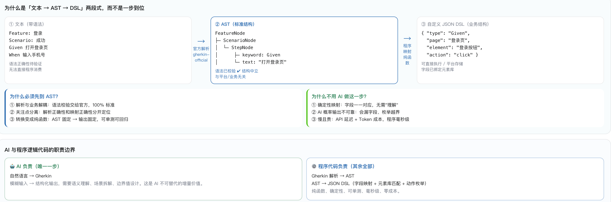
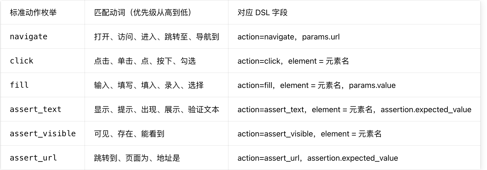

**为什么要先转 AST 再转 DSL**：Gherkin 是「带语法的文本」，你的 JSON DSL 是「结构化数据」，两者之间需要一层**语法中立、标准化的中间结构**——AST。跳过 AST 直接让 AI 从文本生成 DSL，等于把「语法正确性」和「业务映射正确性」两件事混在一起，既不可校验也不可测试。




### 一、先讲透本质：AST 转 DSL 的元素问题到底是什么
AST（抽象语法树）里的每一步 `Step` 本质上只是**一段自然语言文本**（比如 `用户输入手机号 "13800138000"`），而你的自定义 JSON DSL 需要的是**结构化的业务字段**：`page`、`element`、`action`、`params`、`assertion`。

转换的核心矛盾是：
- **左边**：非结构化、表述不固定、存在同义异形的自然语言步骤
- **右边**：强约束、枚举固定、必须与元素库一一对应的结构化字段

所以转换规则的设计目标，就是**用最低成本、最高确定性，把自然语言步骤映射到标准化的业务字段**，同时保证输出的 DSL 100% 可执行。

---

## 二、转换规则的分层设计方案（四层规则体系）
推荐采用「**规则优先 > 语义匹配 > AI兜底 > 校验把关**」的四层架构，越往下越灵活，但确定性逐级降低；80% 以上的标准场景靠前两层就能解决，AI 只处理长尾的模糊场景。

### 第一层：动作映射规则（确定性最高，纯正则）
负责从步骤文本中识别「操作类型」，映射到你的标准动作枚举。这一层**完全用程序规则实现，不用 AI**，准确率接近 100%。

#### 设计方法：动作动词词典 + 正则匹配
维护一个标准动作映射表，每个动作对应一组动词同义词，按优先级匹配：

| 标准动作枚举 | 匹配动词（优先级从高到低） | 对应DSL字段 |
|-------------|--------------------------|------------|
| `navigate` | 打开、访问、进入、跳转至、导航到 | action=navigate，params.url |
| `click` | 点击、单击、点、按下、勾选 | action=click，element=元素名 |
| `fill` | 输入、填写、填入、录入、选择 | action=fill，element=元素名，params.value |
| `assert_text` | 显示、提示、出现、展示、验证文本 | action=assert_text，element=元素名，assertion.expected_value |
| `assert_visible` | 可见、存在、能看到 | action=assert_visible，element=元素名 |
| `assert_url` | 跳转到、页面为、地址是 | action=assert_url，assertion.expected_value |



#### 规则示例
```python
ACTION_RULES = [
    {"action": "navigate", "pattern": r"^(打开|访问|进入).*页面"},
    {"action": "click", "pattern": r"点击(.*?)(按钮|链接|图标|菜单)"},
    {"action": "fill", "pattern": r"在(.*?)输入(.*?)$"},
    {"action": "assert_text", "pattern": r"(显示|提示).*?[\"'](.*?)[\"']"},
]
```

> 这一层解决「动作是什么」的问题，纯确定性，毫秒级执行，零成本。

### 第二层：元素匹配规则（精确→别名→语义三级匹配）
负责从步骤文本中识别「操作的元素」，匹配到元素库中的标准元素。这是转换的核心，也是最容易出问题的地方。

#### 匹配优先级（从高到低，匹配到即停止）
1. **精确匹配**：步骤文本中的元素名与元素库的 `business_name` 完全一致 → 直接返回
2. **别名匹配**：与元素库的 `aliases` 别名列表完全匹配 → 直接返回
3. **语义相似度匹配**：用语义向量计算相似度，Top1 且得分 ≥ 阈值（推荐 0.85）→ 返回
4. **匹配失败**：标记为未找到，进入 AI 兜底层或人工审核

#### 语义匹配实现（开源方案，不用 AI 调用）
用 **sentence-transformers** 本地计算向量相似度，轻量、免费、毫秒级，是工业界元素匹配的标配方案。
- GitHub：https://github.com/UKPLab/sentence-transformers
- 轻量模型：`all-MiniLM-L6-v2`，本地运行，单条查询几毫秒
- 效果：对于同义不同表述的元素名（如「账号框」vs「手机号输入框」），匹配准确率 90%+

### 第三层：页面归属推断规则
AST 里的步骤本身不携带页面信息，需要通过规则推断所属页面，这是很多方案漏掉的关键点。

#### 推断规则
1. **首个 Given 步骤**：默认匹配场景的初始页面（从场景名/前置条件中提取）
2. **页面跳转动作**：遇到 `navigate`、`assert_url` 等动作，更新当前页面上下文
3. **元素唯一匹配**：如果元素名在全库唯一属于某个页面，直接判定该页面
4. **页面流转表**：维护业务页面流转规则（如「点击登录按钮」后页面变为「个人中心」），自动切换上下文

### 第四层：参数提取规则
用正则从步骤文本中提取参数值，比如引号里的输入值、数字、URL等，填充到 `params` 或 `assertion` 字段。

---

## 三、怎么保证转换后的 DSL 一定可用
匹配只是「看起来对」，要做到「真的可用」，必须加三级校验机制，层层过滤错误。

### 第一级：静态结构校验
- 用 JSON Schema 校验 DSL 结构、字段类型、枚举值合法性
- 校验每个元素都能在对应页面的元素库中找到
- 校验动作与元素类型匹配（比如输入框不能执行 click）

### 第二级：语义一致性校验
反向验证：转换后的 DSL 语义是否和原始 Gherkin 步骤完全一致。
- 轻量方案：规则校验关键信息点（动作、元素、参数）没有遗漏
- 高级方案：用小模型或 Embedding 计算语义相似度，低于阈值打回

### 第三级：Dry-run 定位预验证（最有效，强烈推荐）
**这是保证可执行的终极手段**：不执行业务逻辑，只启动 Playwright 无头浏览器，打开对应页面，逐个验证 DSL 中的定位器是否真的能找到元素。

```
执行流程：
1. 启动 Playwright → 打开目标页面 URL
2. 遍历 DSL 中的每个步骤
3. 根据元素库的定位器实际查找元素
4. 全部找到 → 校验通过
5. 找不到 → 触发自动修复 / 标记人工审核
```

> 只要通过 Dry-run 校验的 DSL，100% 是可执行的，这比任何 AI 或规则都靠谱。

---

## 四、这一步用 AI 好不好？适用边界与正确定位
### 结论先说：**不推荐用 AI 直接生成最终 DSL，但非常适合做「实体提取 + 匹配兜底」**

| 方案 | 优点 | 缺点 | 推荐度 |
|------|------|------|--------|
| 纯规则+语义匹配 | 确定性100%、性能极高、零成本、可测试 | 对非标准表述召回率低 | ⭐⭐⭐⭐ 主力方案 |
| AI直接生成DSL | 灵活性高，能处理模糊表述 | 不可控、会瞎编元素、成本高、无法测试 | ⭐ 不推荐 |
| AI提取实体 + 程序匹配生成 | 兼顾语义理解能力和结果确定性 | 增加少量成本和复杂度 | ⭐⭐⭐⭐⭐ 推荐兜底方案 |

### AI 的正确用法：实体提取器
不让 AI 生成最终 DSL，只让它做一件事：**从步骤文本中提取结构化实体**，然后交给程序去匹配元素库、生成 DSL。

#### 示例：AI 只输出结构化实体
输入步骤：`用户在手机号框里输入13800138000`
AI 输出（严格结构化）：
```json
{
  "action_type": "fill",
  "element_name": "手机号输入框",
  "param_value": "13800138000",
  "page_hint": "登录页面"
}
```
然后程序用这个输出去匹配元素库，生成标准 DSL。

> 好处：AI 发挥语义理解优势，程序保证结构和数据正确性，既提升了模糊场景的召回率，又保留了确定性。

#### 技术实现（基于 LangChain + Bedrock）
用 LangChain 的**结构化输出（Structured Output）** 或**工具调用**功能，强制 AI 按固定 JSON 格式输出，不会自由发挥。
- 无需自己写正则、处理各种表述
- 支持复杂复合步骤的拆分（如「输入账号密码并登录」拆成两步）
- 成本极低，单条提取仅需几十分钱

---

## 五、可复用的 GitHub 开源方案与组件
没有开箱即用的「AST 转自定义 DSL」成品（因为每个公司 DSL 都不一样），但有非常成熟的组件可以直接复用，覆盖匹配、提取、校验全链路。

### 1. 语义匹配底座：sentence-transformers
- **GitHub**：https://github.com/UKPLab/sentence-transformers
- **Star**：≈63.7k
- **作用**：本地计算文本向量相似度，做元素名称的语义匹配
- **为什么用**：轻量、免费、本地运行、毫秒级响应，是元素语义检索的工业标准
- **适用场景**：第二层元素匹配的核心引擎，替代简单的字符串匹配

### 2. 实体提取框架：LangChain 结构化输出
- **GitHub**：https://github.com/langchain-io/langchain
- **Star**：≈93k
- **作用**：封装 Bedrock 等大模型，强制输出固定结构的 JSON 实体
- **为什么用**：不用自己写 Prompt 约束、解析返回结果、处理重试，一行代码实现结构化提取
- **适用场景**：AI 兜底层的实体提取，处理规则匹配失败的模糊步骤

### 3. 元素动态查询：AgentQL
- **GitHub**：https://github.com/agentql/agentql
- **Star**：≈1.3k
- **作用**：自然语言直接查询页面元素，基于 Playwright 实时返回定位器
- **为什么用**：当元素库没有对应元素时，可以用它实时从页面中查找元素，作为元素库的补充
- **适用场景**：Dry-run 定位失败时的自动修复，或者新页面未录入元素库时的临时兜底

### 4. 参考架构：Microsoft AutoGenesis
- **GitHub**：https://github.com/microsoft/AutoGenesis
- **Star**：≈1.1k
- **作用**：微软 Edge 团队开源的自动化测试生成完整架构
- **为什么用**：里面有完整的「自然语言步骤 → 页面元素映射 → 测试生成」流水线设计，可以直接复用它的匹配策略、校验流程、分层设计思想
- **适用场景**：整体架构参考，不用重复造轮子

### 5. 语义校验：Ragas
- **GitHub**：https://github.com/explodinggradients/ragas
- **Star**：≈14k
- **作用**：语义相似度评估框架
- **为什么用**：用来校验转换后的 DSL 和原始 Gherkin 步骤的语义一致性，自动发现遗漏、偏差
- **适用场景**：第二级语义一致性校验

---

## 六、推荐落地方案（分阶段实施）
### 第一阶段：纯规则 + 语义匹配（覆盖 80% 场景）
- 实现动作映射规则、元素三级匹配、页面推断、参数提取
- 接入 sentence-transformers 做语义匹配
- 加上静态结构校验
- 开发量小，确定性高，先跑通主流程

### 第二阶段：AI 兜底 + 语义校验（提升到 95%+ 召回率）
- 接入 LangChain + Bedrock 做实体提取兜底
- 规则匹配失败的步骤自动走 AI 提取
- 加上语义一致性校验
- 用少量 AI 成本解决长尾模糊场景

### 第三阶段：Dry-run 预验证（保证 100% 可用）
- 实现 Playwright 无头 Dry-run 机制
- 定位失败的触发 AgentQL 自动修复
- 结果回流更新元素库别名
- 最终输出的 DSL 全部经过实际页面验证

---

## 七、最终结论
1. **AST 转 DSL 的主体必须是程序规则**，确定性、可维护性、性能都远优于纯 AI；
2. **元素匹配核心靠「元素库 + 语义向量」**，sentence-transformers 是标配，不用调用大模型；
3. **AI 只适合做兜底补充**，负责处理模糊表述、复合步骤拆分，不要让 AI 直接生成最终 DSL；
4. **可用性的终极保障是 Dry-run 预验证**，比任何规则和 AI 都靠谱。

需要我给你一份「规则+语义匹配+AI兜底」三层转换的完整 Python 代码示例吗？包含动作映射、sentence-transformers 语义匹配、LangChain 实体提取三个部分。