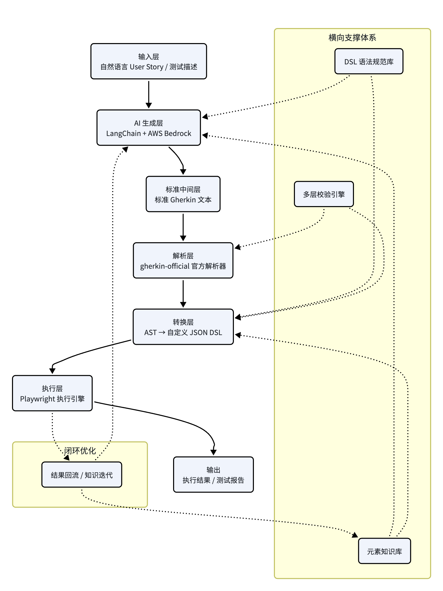

# 自然语言驱动的自动化测试 AI 转换架构

# 架构总览

本架构实现「自然语言需求 → 标准 Gherkin → 自定义 JSON DSL → Playwright 自动化执行」的完整转换链路，采用**分层解耦、流水线式处理**的设计，贯穿需求分析、用例生成、结构解析、格式转换、自动执行五大环节。整体遵循 Python 技术栈与 AWS Bedrock 技术体系，并配备元素知识库、多层校验、闭环优化等生产级能力。

# 整体设计思路

架构的核心原则是**最大程度复用成熟开源组件，仅在业务定制层做少量开发**，避免从零搭建解析器、AI 框架、执行引擎等基础能力。

- **分层解耦**：每一层只负责一个职责，层与层之间通过标准格式（Gherkin 文本、AST、JSON DSL）衔接，任意一层可独立替换升级。

- **开源优先**：Gherkin 解析复用 Cucumber 官方 gherkin\-official，AI 编排复用 LangChain，执行复用 Playwright，自研代码占比不到 30%。

- **元素与 DSL 分离**：元素定位信息全部来自元素知识库，AI 与转换逻辑均不直接生成定位器，从根源避免编造问题。

- **生产级闭环**：通过多层校验保证转换质量，通过结果回流形成持续优化的自学习闭环。

# 各层级详细说明

## 输入层：自然语言需求

- **定位**：整条链路的业务入口，对接需求来源。

- **输入**：Jira User Story、验收标准、PRD 片段、人工编写的自然语言测试描述。

- **输出**：结构化预处理后的纯文本需求。

**核心职责**：对接 Jira 等需求系统按条件拉取用户故事与验收标准；清洗富文本格式、冗余标记与无效信息，提取核心测试要素；统一输入格式，为 AI 生成层提供标准化文本。实现方式为轻量定制开发，可基于 Jira Python SDK 快速实现数据拉取与清洗。

## AI 生成层：LangChain \+ AWS Bedrock

- **定位**：整条链路的智能核心，负责自然语言到标准 Gherkin 的语义转换。

- **核心组件**：编排框架 LangChain（模型调用、工具编排、多轮对话管理、重试机制）；大模型 AWS Bedrock Claude 3\.5 Sonnet（语义理解、场景拆解、Gherkin 生成）；扩展工具为元素查询工具（对接元素知识库，强制 AI 通过工具获取元素信息）。

- **输入**：标准化自然语言需求 \+ 元素知识库上下文 \+ DSL 规范约束。

- **输出**：符合 Cucumber 官方语法的标准 Gherkin 文本。

**核心职责**：拆解需求并自动规划正常流、异常流、边界值场景；调用元素查询工具获取页面元素信息，确保业务描述可落地；严格遵循 Gherkin 语法规范与团队术语生成用例。关键复用价值：无需自研 Bedrock API 封装、工具调用调度与重试逻辑，直接复用 LangChain 成熟能力；复用业界成熟的 BDD 生成 Prompt 范式，仅做业务术语与规则替换；开发量仅为纯自研方案的 20% 左右。

## 标准中间层：标准 Gherkin 文本

- **定位**：AI 生成层与解析层之间的标准中间格式，是业务与技术的分界线。

- **格式**：严格遵循 Cucumber 官方 Gherkin 语法规范。

**核心价值**：一是**业务技术解耦**，产品、测试、开发三方均可直接评审 Gherkin 用例，无需关注底层实现；二是**引擎无关性**，上层用例不绑定任何执行框架，未来可无缝切换任意 BDD 执行引擎；三是**标准化**，所有下游解析、转换都基于统一标准，避免自定义语法的兼容问题。

## 解析层：gherkin\-official 官方解析器

- **定位**：Gherkin 语法的标准解析引擎，负责文本到结构化 AST 的转换。

- **核心组件**：gherkin\-official（Cucumber 官方开源 Python 包，100% 复用）。

- **输入**：标准 Gherkin 文本。

- **输出**：标准 AST（抽象语法树）结构化节点。

**核心职责**：语法校验（验证 Gherkin 语法合法性，输出精确的行列级错误信息）；结构解析（将 Feature、Scenario、Step、参数、标签等解析为标准化节点对象）；格式归一（统一处理缩进、换行、注释、空格等格式问题）。关键复用价值：完全不用自研 Gherkin 解析器，从根源避免语法边界与兼容问题；官方持续维护，支持最新 Gherkin 语法特性；解析性能与准确率远高于自研实现。

## 转换层：AST → 自定义 JSON DSL 映射

- **定位**：标准生态到平台自定义格式的适配层，是整条链路中定制开发量最小的核心层。

- **核心组件**：轻量定制转换函数 \+ 元素知识库匹配逻辑。

- **输入**：Gherkin 标准 AST 节点。

- **输出**：符合平台规范的自定义 JSON DSL。

**核心职责**：字段映射（将 AST 的 Feature / Scenario / Step 节点映射到自定义 DSL 的对应字段）；元素匹配（调用元素知识库，将业务元素名匹配到结构化定位器）；动作映射（将自然语言动作映射为平台标准动作枚举 navigate / click / fill / assert 等）。关键说明：代码量极小，仅需几十行遍历与映射逻辑；所有结构规则来自 DSL 规范库，所有元素信息来自元素知识库；是连接标准开源生态与平台自定义体系的唯一适配层。

## 执行层：Playwright 自动化执行引擎

- **定位**：DSL 的最终执行层，负责驱动浏览器完成测试。

- **核心组件**：Playwright 原生 API \+ 自定义执行映射引擎。

- **输入**：自定义 JSON DSL。

- **输出**：测试执行结果、截图、日志、标准化测试报告。

**核心职责**：根据 DSL 中的动作枚举映射到对应 Playwright API；根据结构化定位器生成 Playwright Locator 并执行操作；执行断言、捕获错误、生成执行报告。实现方式为复用已有 Playwright 执行能力，无需额外开发。

# 核心支撑体系

横向贯穿全链路的基础能力，是保证转换准确性与可执行性的核心：

- **元素知识库**：按页面维度维护业务元素名称、别名、结构化定位器、前置条件；为 AI 生成层与转换层提供唯一的元素定位数据源，从根源避免 AI 编造定位器的问题。

- **DSL 语法规范库**：定义自定义 JSON DSL 的字段规范、动作枚举、断言规则；配套 JSON Schema 做结构强校验；统一 AI 生成与转换层的输出标准。

- **多层校验引擎**：语法校验（解析层 Gherkin 语法校验 \+ 转换层 JSON Schema 结构校验）；元素校验（验证所有操作元素均可在知识库中找到对应定位器）；语义校验（AI 反向核对输入输出语义一致性，避免遗漏或偏差）。

# 闭环优化机制

执行结果反向回流，形成自学习闭环，持续提升转换准确率：

1. 执行成功的用例自动回流为高质量样本，优化 AI 生成效果。

2. 人工修正的元素别名自动同步到元素知识库，提升后续匹配率。

3. 定位失败的场景自动触发多模态重识别，更新元素库定位器。

4. 定期统计失败类型，迭代 Prompt 模板与转换规则。

# 开源复用与定制开发占比

|模块|实现方式|代码量占比|说明|
|---|---|---|---|
|**AI 生成编排**|复用 LangChain \+ 业务定制|\~20%|框架全复用，仅定制 Prompt 与工具|
|**Gherkin 解析**|100% 复用 gherkin\-official|0%|官方库直接调用，无需开发|
|**AST 转自定义 DSL**|轻量定制开发|\~10%|仅字段映射与匹配逻辑|
|**元素知识库**|定制数据结构 \+ 检索逻辑|\~10%|可基于向量数据库快速搭建|
|**执行引擎**|已有能力复用|0%|复用现有 Playwright 引擎|
|**校验与闭环**|少量定制开发|\~20%|基于开源组件拼装|

**整体自研代码占比约 30%，70% 以上能力来自成熟开源组件与已有能力，完全无需从零搭建。**

> （注：部分内容由豆包工作 AI 生成）
